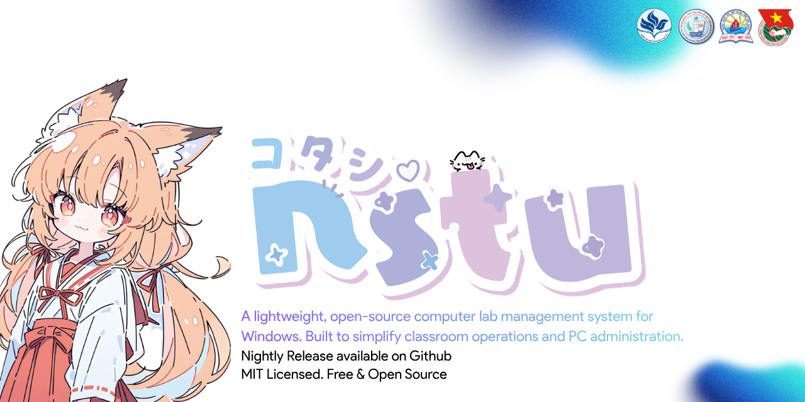
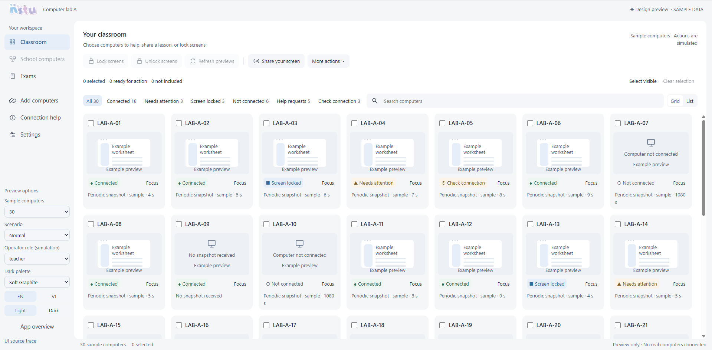
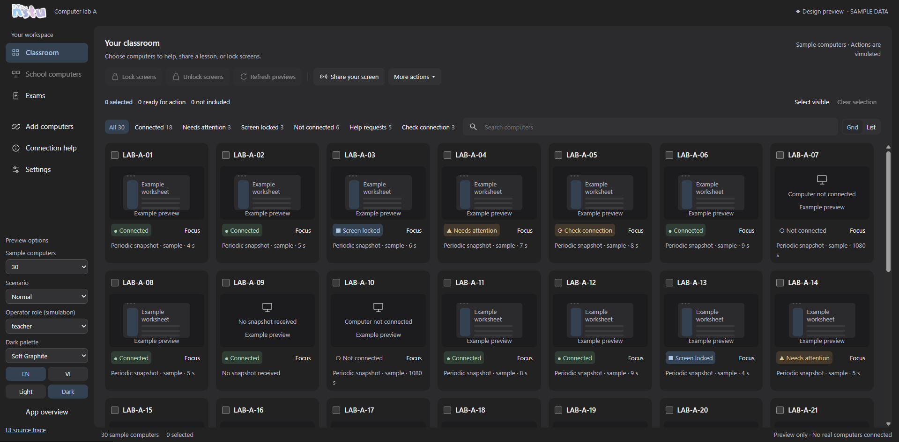

# Project NSTU

[English](README.md) | [Tiếng Việt](README.vi.md)

**Bringing the examination lifecycle to computers.**

Project NSTU is an open-source initiative to digitize the complete examination lifecycle: preparing assessments, organizing examinations, supervising candidates, collecting submissions, judging, reviewing decisions and publishing results.

Classroom and computer-lab management provide supporting infrastructure for this goal. The current repository contains Windows classroom and assessment foundations; the complete examination workflow is still **In Progress**.

## Why Project NSTU

Teachers and examination organizers need a practical digital workflow connecting assessment content, people, rooms, candidate tools, submissions and result review.

## The examination lifecycle

These product areas describe the project's scope, including future work:

| Area | Purpose |
| --- | --- |
| Exam authoring | Prepare questions, media and reference material. |
| Exam management | Organize events, subjects, sessions and candidates. |
| Exam room operations | Assign rooms and seats, verify devices, support physical and digital supervision. |
| Candidate workspaces | Provide the tools and examination environment candidates are permitted to use. |
| Submission and evidence | Collect work, preserve evidence and support verifiable acceptance receipts. |
| Automated and programming judging | Develop marking workflows and isolated official programming judging. |
| Adjudication and publication | Review results and exceptions, finalize decisions and control publication. |

## Current repository and development status

The codebase includes a Windows teacher console, background service and interactive client, alongside the Exam Studio authoring interface and browser assessment runner. Automated coverage includes protocol, persistence, snapshot and browser-state components.

**Implemented** describes component-level engineering and verification. Native operation, complete workflows and deployment require separate qualification.

| Maturity | Current scope |
| --- | --- |
| **Implemented** | Teacher/client foundations, LAN communication and snapshot/broadcast components, assessment templates and answer-storage components with automated tests. |
| **In Progress** | Complete pairing and assessment round trips; package compatibility; Focus and candidate hosted operation/recovery; installation, Windows usability including keyboard/screen-reader accessibility, policy and room-capacity qualification. |
| **Planned** | A lightweight independent desktop Exam Studio for offline authoring on ordinary teacher laptops without requiring classroom/server installation; examination/event management, room/seat assignment and supervised programming workspaces. |
| **Research / Under Evaluation** | Secure Setter/signing workflows, Room Kit and evidence custody/receipts, an isolated Central Judge, adjudication and event-wide result publication. |

**Authoring direction:** Save is the primary document operation for preserving a working assessment. Export produces an examination package after validation; the complete Save/Open/import/export round trip remains **In Progress**.

## Candidate workspace direction

The **Planned** programming workspace is supervised: approved IDEs, compilers, interpreters, debuggers, local testing tools and accessibility software should remain usable. Examination policies should restrict unapproved Internet access and unauthorized candidate-to-candidate communication while preserving authorized local work and NSTU services.

The current repository also contains restrictive WebView2 exam-host code. Its native behavior and permitted-tool policies remain under qualification.

## Architecture overview

Current implementation centers on:

- A Windows teacher application coordinating classroom devices.
- A background service and desktop client on each workstation.
- The Exam Studio authoring interface, browser assessment runner and answer-storage components.

Independent Studio deployment and event/room orchestration are **Planned**. Room collection, evidence custody and central judging service boundaries remain **Research / Under Evaluation**. Official programming judging is intended to run separately from candidate workstations, with hidden tests and checkers held centrally.

## Documentation

Installation and operational acceptance are still **In Progress**. These guides support development and qualification:

- [Setup guide](docs/SETUP_GUIDE.md) and [local qualification](docs/LOCAL_QUALIFICATION.md).
- [Development guide](docs/DEVELOPMENT.md) and [architecture](docs/ARCHITECTURE.md).
- [Assessment workflows](docs/EXAM_ASSESSMENT.md) and [Exam Studio](exam/studio/README.md).
- [Security](docs/SECURITY.md) and [optional diagnostics/privacy](docs/TELEMETRY.md).
- [VM testing](docs/VM_TESTING.md) and [production validation requirements](docs/PRODUCTION_VALIDATION.md).

## Contributing

Start with the development guide and [project issues](https://github.com/Khoasoma/nstu/issues). Propose scoped changes, include relevant verification evidence, respect component licensing and keep English/Vietnamese documentation aligned.

Existing project credits include Lê Anh Tuấn, Bùi Hồ Hải Đăng and Nguyễn Thị Hồng Quyên. See also the [repository contributors](https://github.com/Khoasoma/nstu/graphs/contributors).

Interface design previews

Sample data and simulated actions; these images are design previews.

## License

Project NSTU is released under the [MIT License](LICENSE). Component-specific licensing information is retained in [THIRD_PARTY_NOTICES.md](THIRD_PARTY_NOTICES.md).
