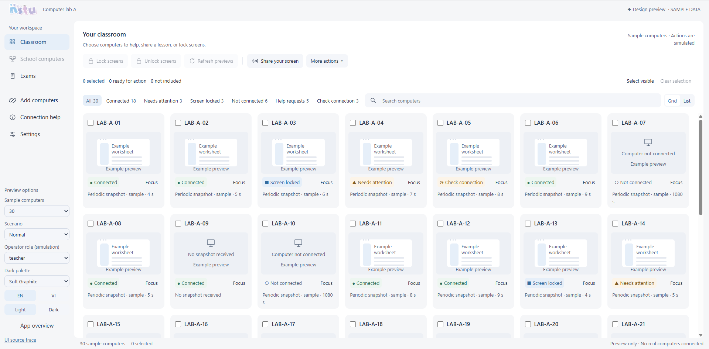
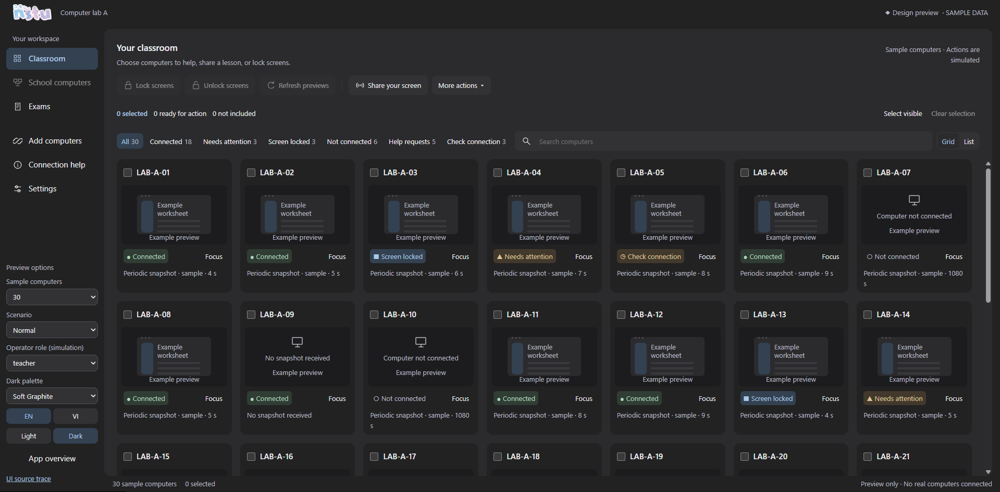

# Project NSTU

[English](README.md) | [Tiếng Việt](README.vi.md)

**Số hóa toàn bộ quy trình tổ chức kỳ thi.**

Project NSTU là một dự án mã nguồn mở hướng tới số hóa toàn bộ vòng đời kỳ thi: soạn đề, tổ chức thi, giám sát thí sinh, thu bài, chấm thi, xét duyệt và công bố kết quả.

Quản lý lớp học và phòng máy là hạ tầng hỗ trợ mục tiêu này. Kho mã hiện có các nền tảng quản lý phòng máy và bài thi trên Windows; quy trình thi hoàn chỉnh vẫn **Đang phát triển**.

## Vì sao cần Project NSTU

Giáo viên và người tổ chức kỳ thi cần một quy trình số thiết thực kết nối đề thi, người tham gia, phòng thi, công cụ của thí sinh, bài nộp và việc xét duyệt kết quả.

## Vòng đời kỳ thi

Các mảng sau thể hiện phạm vi của dự án, bao gồm cả công việc trong tương lai:

| Mảng sản phẩm | Mục đích |
| --- | --- |
| Soạn đề | Chuẩn bị câu hỏi, nội dung đa phương tiện và tài liệu tham khảo. |
| Quản lý kỳ thi | Tổ chức sự kiện thi, môn thi, ca thi và danh sách thí sinh. |
| Vận hành phòng thi | Phân phòng, xếp chỗ, xác minh thiết bị, hỗ trợ giám sát trực tiếp và qua hệ thống. |
| Không gian làm bài | Cung cấp môi trường và công cụ thí sinh được phép sử dụng. |
| Bài nộp và minh chứng | Thu bài, lưu giữ minh chứng và hỗ trợ biên nhận có thể kiểm chứng. |
| Chấm thi tự động và chấm bài lập trình | Phát triển quy trình chấm điểm và mô hình chấm lập trình chính thức được tách biệt. |
| Xét duyệt và công bố | Rà soát kết quả, xử lý ngoại lệ, chốt quyết định và quản lý việc công bố. |

## Kho mã hiện tại và trạng thái phát triển

Kho mã có ứng dụng giáo viên, dịch vụ nền và ứng dụng tương tác trên Windows, cùng giao diện Exam Studio và các thành phần bài thi chạy trên trình duyệt. Kiểm thử tự động bao phủ các thành phần giao thức, lưu trữ, ảnh chụp màn hình và trạng thái trình duyệt.

**Đã xây dựng** thể hiện mức độ hoàn thành và kiểm chứng của từng thành phần. Hoạt động thực tế trên Windows, quy trình hoàn chỉnh và khả năng triển khai cần được kiểm chứng riêng.

| Mức độ hoàn thiện | Phạm vi hiện tại |
| --- | --- |
| **Đã xây dựng (Implemented)** | Nền tảng ứng dụng giáo viên/máy trạm, giao tiếp mạng nội bộ, các thành phần chụp/phát màn hình, mẫu bài thi và lưu trữ câu trả lời có kiểm thử tự động. |
| **Đang phát triển (In Progress)** | Quy trình ghép nối và lưu/mở/nhập/xuất bài thi hoàn chỉnh; tương thích gói thi; hoạt động và khôi phục của Focus/môi trường làm bài; kiểm chứng cài đặt, sử dụng ứng dụng Windows bằng bàn phím/trình đọc màn hình, chính sách và năng lực phòng máy. |
| **Đã lên kế hoạch (Planned)** | Exam Studio dạng ứng dụng desktop nhẹ để soạn đề ngoại tuyến trên laptop giáo viên thông thường, không cần cài đặt hệ thống phòng máy/máy chủ; quản lý kỳ thi/sự kiện, phân phòng/xếp chỗ và không gian lập trình có giám sát. |
| **Nghiên cứu / Đang đánh giá (Research / Under Evaluation)** | Secure Setter/quy trình ký, Room Kit và quản lý minh chứng/biên nhận, Central Judge tách biệt, xét duyệt và công bố kết quả trên toàn sự kiện thi. |

**Định hướng soạn đề:** Save là thao tác chính để lưu bài thi đang soạn. Export tạo gói thi sau khi kiểm tra tính hợp lệ; quy trình lưu, mở, nhập và xuất bài thi hoàn chỉnh vẫn **Đang phát triển**.

## Định hướng không gian làm bài

Không gian lập trình có giám sát là hướng **Đã lên kế hoạch**. Thí sinh cần được sử dụng IDE, trình biên dịch/thông dịch, trình gỡ lỗi, công cụ kiểm thử cục bộ và công cụ trợ năng theo quy định của kỳ thi. Chính sách cần hạn chế truy cập Internet không được phép và trao đổi trái phép giữa thí sinh, đồng thời duy trì công việc cục bộ và các dịch vụ NSTU hợp lệ.

Kho mã hiện có phần chạy bài thi trong WebView2 với các giới hạn. Hoạt động thực tế trên Windows và chính sách cho phép công cụ vẫn đang được kiểm chứng.

## Tổng quan kiến trúc

Phần triển khai hiện tại tập trung vào:

- Ứng dụng giáo viên trên Windows để điều phối thiết bị trong lớp học.
- Dịch vụ nền và ứng dụng desktop trên mỗi máy trạm.
- Giao diện soạn đề Exam Studio, phần chạy bài thi trên trình duyệt và các thành phần lưu trữ câu trả lời.

Triển khai Studio độc lập và điều phối sự kiện/phòng thi là **Đã lên kế hoạch**. Ranh giới các dịch vụ thu bài tại phòng, quản lý minh chứng và chấm tập trung vẫn **Nghiên cứu / Đang đánh giá**. Chấm lập trình chính thức được định hướng tách khỏi máy thí sinh, với test ẩn và checker được giữ ở phía trung tâm.

## Tài liệu

Kiểm chứng cài đặt và vận hành vẫn **Đang phát triển**. Các tài liệu dưới đây phục vụ phát triển và kiểm chứng:

- [Hướng dẫn thiết lập](docs/SETUP_GUIDE.vi.md) và [kiểm chứng cục bộ](docs/LOCAL_QUALIFICATION.vi.md).
- [Hướng dẫn phát triển](docs/DEVELOPMENT.vi.md) và [kiến trúc](docs/ARCHITECTURE.vi.md).
- [Quy trình đánh giá/bài thi](docs/EXAM_ASSESSMENT.vi.md) và [Exam Studio](exam/studio/README.md).
- [Bảo mật](docs/SECURITY.vi.md) và [chẩn đoán tùy chọn/quyền riêng tư](docs/TELEMETRY.vi.md).
- [Kiểm thử bằng máy ảo](docs/VM_TESTING.vi.md) và [yêu cầu kiểm chứng triển khai](docs/PRODUCTION_VALIDATION.vi.md).

## Đóng góp

Bắt đầu từ hướng dẫn phát triển và [các vấn đề của dự án](https://github.com/Khoasoma/nstu/issues). Đề xuất thay đổi có phạm vi rõ ràng, kèm bằng chứng kiểm chứng phù hợp, tuân thủ giấy phép của các thành phần và cập nhật tài liệu Anh/Việt đồng bộ.

Các ghi nhận đóng góp hiện có gồm Lê Anh Tuấn, Bùi Hồ Hải Đăng và Nguyễn Thị Hồng Quyên. Xem thêm [những người đóng góp trên kho mã](https://github.com/Khoasoma/nstu/graphs/contributors).

Xem trước thiết kế giao diện

Ảnh xem trước thiết kế sử dụng dữ liệu mẫu và thao tác mô phỏng.

## Giấy phép

Project NSTU được phát hành theo [giấy phép MIT](LICENSE). Thông tin giấy phép của từng thành phần được giữ trong [THIRD_PARTY_NOTICES.md](THIRD_PARTY_NOTICES.md).
