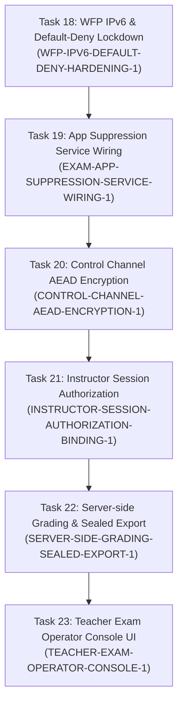

# Phase 5: Exam Hardening, Network Lockdown & Production Delivery Plan — November 1, 2026

## 1. Executive Summary & Context

With Phase 4 (Tasks 0–16) complete, the discrete exam timing telemetry channel, outbox, server journal/dedup, async persistence worker, and cross-channel integration tests are implemented and merged into `main` (`79d1fdfb9f17f631d2e5fd5caa031fbe66e07d7c`).

Per [tasks/luna-workflow.md](file:///C:/Users/xkhoa/Documents/Codex/2026-08-30/im/work/nstu/tasks/luna-workflow.md) and [REVISED_ROADMAP.md](file:///C:/Users/xkhoa/Documents/Codex/2026-08-30/im/work/nstu/REVISED_ROADMAP.md) section **E3 ("Close official-exam security and production gates")**, Phase 4 completion establishes the telemetry and answer pipeline, but does not yet make exam mode fully exam-safe or production-operable.

Phase 5 addresses the critical production security, isolation, authorization, and operator capabilities required for official computer-based assessment.

---

## 2. Phase 5 Task Breakdown & Architecture

---

### Task 18: WFP IPv6 & Default-Deny Lockdown (`WFP-IPV6-DEFAULT-DENY-HARDENING-1`)

- **Objective**: Harden the Windows Filtering Platform (WFP) website and egress allowlist against network escape and IPv6 bypass.
- **Current Limitation**: Current WFP primitive in `common/src/wfp_allowlist.cpp` only binds `ALE_AUTH_CONNECT_V4` and filters ports 80/443 with per-IP permits; IPv6 traffic and non-HTTP ports are not blocked.
- **Scope & Implementation**:
  1. Bind both `ALE_AUTH_CONNECT_V4` and `ALE_AUTH_CONNECT_V6` layers.
  2. Implement outbound **default-deny block filter** at sublayer `kSubLayerKey`.
  3. Add higher-weight permit rules for essential exam traffic:
     - Local loopback (`127.0.0.1` and `::1`) for WebView2 virtual host `https://nstu.exam/` and local named pipes.
     - Teacher server IP (IPv4 and IPv6) and control/video port (`g_server_port`).
     - Local DHCP (IPv4 UDP 67/68, IPv6 UDP 546/547) and local DNS (UDP/TCP 53) to maintain link connectivity.
     - Declared package online document origins (resolved at arm time).
  4. Ensure all filter objects use dynamic (non-persistent) session filters so engine failure or OS crash cannot permanently strand a student workstation.
- **Allowlisted Files**:
  - `common/include/nstu/wfp_allowlist.hpp`
  - `common/src/wfp_allowlist.cpp`
  - `client/include/nstu/exam_lockdown_controller.hpp`
  - `client/src/exam_lockdown_controller.cpp`
  - `tests/wfp_allowlist_tests.cpp`
- **Acceptance Criteria**:
  - Outbound IPv4 and IPv6 traffic to unauthorized destinations is blocked.
  - Teacher server control channel and loopback WebView2 virtual host remain unimpeded.
  - Fail-safe disarm clears all filters upon stop, disconnect, or timeout.
  - 100% tests pass under `-Werror` Release and MSVC `/W4 /WX`.

---

### Task 19: App Suppression Service Lifecycle Wiring (`EXAM-APP-SUPPRESSION-SERVICE-WIRING-1`)

- **Objective**: Wire active application suppression into `nstu-service` to terminate prohibited software during an exam.
- **Current Limitation**: `ExamAppSuppression` (`client/include/nstu/exam_app_suppression.hpp`) exists as pure classification policy; it is not hooked into process enumeration or `client/service/main.cpp`.
- **Scope & Implementation**:
  1. Author `ProcessEnumerator` and `AppSuppressionExecutor` in `client/` using Windows Toolhelp32 / `EnumProcesses` APIs.
  2. Wire into `client/service/main.cpp` active exam state machine:
     - Arms upon `exam_start`, disarms upon `exam_stop`, disconnect, or watchdog timeout.
     - Scans user sessions every 2 seconds while active.
     - Enforces non-negotiable protection floor (`kProtectedImages`: Windows core `csrss.exe`, `lsass.exe`, `dwm.exe`, `explorer.exe`, `msedgewebview2.exe`, NSTU binaries).
     - Issues `TerminateProcess` only for unauthorized user-mode processes in student sessions (never Session 0 services).
     - Emits structured audit events (`Category::exam`, `action="app_suppress"`) logging suppressed process image name and PID.
- **Allowlisted Files**:
  - `client/include/nstu/exam_app_suppression.hpp`
  - `client/src/exam_app_suppression.cpp`
  - `client/service/main.cpp`
  - `tests/exam_app_suppression_tests.cpp`
- **Acceptance Criteria**:
  - Prohibited user applications (e.g., browsers, chat apps, calculators) are terminated when armed.
  - Critical OS processes, desktop shell, NSTU binaries, and WebView2 kiosk are never terminated.
  - Disarming or service shutdown immediately ceases process termination.
  - Unit and integration tests pass with zero compiler warnings.

---

### Task 20: Control Channel AEAD Encryption (`CONTROL-CHANNEL-AEAD-ENCRYPTION-1`)

- **Objective**: Add confidentiality and authenticated encryption with associated data (AEAD) to the control channel.
- **Current Limitation**: Current protocol authenticates frames with HMAC-SHA256, but payloads (screens, answers, notes, chat) are transmitted in plaintext across the local network.
- **Scope & Implementation**:
  1. Implement AEAD cipher suite (AES-256-GCM using Windows CNG `BCryptEncrypt`/`BCryptDecrypt`) in `common/src/control_channel.cpp`.
  2. Derive independent directional session keys (`client_to_server_key`, `server_to_client_key`) and 96-bit nonces from session master secret during handshake.
  3. Handshake negotiation: add capability bit `kCapabilityAead` to handshake preamble, allowing graceful backward compatibility.
  4. Encrypt sensitive payloads (screen JPEG frames, answer events, chat, telemetry) while retaining fixed header envelopes.
- **Allowlisted Files**:
  - `common/include/nstu/control_channel.hpp`
  - `common/src/control_channel.cpp`
  - `server/include/nstu/control_plane.hpp`
  - `server/src/control_plane.cpp`
  - `tests/control_channel_tests.cpp`
- **Acceptance Criteria**:
  - Payloads on the wire cannot be decrypted or inspected without the negotiated session key.
  - Nonce reuse is strictly forbidden via monotonic 64-bit sequence counters.
  - Tampered frames fail authentication tag verification and are dropped.
  - Zero performance regression on high-frame-rate snapshot streaming.

---

### Task 21: Instructor / Session Authorization Binding (`INSTRUCTOR-SESSION-AUTHORIZATION-BINDING-1`)

- **Objective**: Bind official assessments to cryptographic instructor authorization tickets.
- **Current Limitation**: Pairing SAS authenticates device pairing, but does not bind official proctored assessment sessions or instructor credentials.
- **Scope & Implementation**:
  1. Define canonical `InstructorAuthorizationTicket`:
     - `instructor_id` (UUID / string)
     - `package_id` and `package_digest` (SHA-256)
     - `session_id` and `candidate_id`
     - `valid_from_ms` and `valid_until_ms`
     - `instructor_signature` (HMAC-SHA256 or Ed25519)
  2. Implement ticket encoder, decoder, and cryptographic validator in `common/include/nstu/exam_auth.hpp`.
  3. Extend `ServerControlPlane::start_exam` to require and verify the authorization ticket before creating `ActiveExamContext`.
  4. Emit audit log with severity `info` on success or `warning` on invalid/expired ticket.
- **Allowlisted Files**:
  - `common/include/nstu/exam_auth.hpp`
  - `common/src/exam_auth.cpp`
  - `server/include/nstu/control_plane.hpp`
  - `server/src/control_plane.cpp`
  - `tests/control_plane_exam_auth_tests.cpp`
- **Acceptance Criteria**:
  - Official exams start only with valid, signed instructor tickets within validity windows.
  - Expired, tampered, or mismatched tickets fail admission with explicit audit records.
  - Unit and integration tests pass cleanly.

---

### Task 22: Server-side Grading & Sealed Export (`SERVER-SIDE-GRADING-SEALED-EXPORT-1`)

- **Objective**: Provide automated grading for objective questions, manual review workflows for essays, and tamper-evident sealed exports.
- **Current Limitation**: Server stores opaque answer bytes by design; grading and scoring require manual offline processing.
- **Scope & Implementation**:
  1. Author `ExamGrader` in `server/include/nstu/exam_grader.hpp`:
     - Reads server-side answer key (never bundled in client package).
     - Auto-grades objective questions (`multiple_choice`, `short_answer`).
     - Scores items based on manifest point weights and question IDs.
     - Flags `essay` and free-form responses for proctor review.
  2. Author `SealedExport` generator:
     - Packages student responses, scores, question revisions, timing logs, and proctor notes into a standardized ZIP container.
     - Generates detached SHA-256 checksum manifest and digital signature seal.
- **Allowlisted Files**:
  - `server/include/nstu/exam_grader.hpp`
  - `server/src/exam_grader.cpp`
  - `server/include/nstu/sealed_export.hpp`
  - `server/src/sealed_export.cpp`
  - `tests/exam_grader_tests.cpp`
- **Acceptance Criteria**:
  - Objective items are accurately scored according to server-side keys.
  - Answer keys are never disclosed to clients or written to client logs.
  - Sealed exports are deterministic, tamper-evident, and verifiable via SHA-256 manifest.

---

### Task 23: Teacher Exam Operator Console UI (`TEACHER-EXAM-OPERATOR-CONSOLE-1`)

- **Objective**: Integrate end-to-end exam management and live monitoring into the teacher dashboard (`server/app/main.cpp`).
- **Current Limitation**: Start/stop APIs exist in `control_plane.cpp`, but `server/app/main.cpp` has no exam control panel; exams cannot currently be launched from the GUI.
- **Scope & Implementation**:
  1. Add dedicated **Exam Management** tab to Dear ImGui teacher dashboard.
  2. Implement Package Picker: discovers staged `.nstuexam` packages in server storage.
  3. Implement Client Roster Selection: select individual or all enrolled online clients.
  4. Display UWF fleet protection status and explain why any client is blocked.
  5. Implement Launch / Stop controls calling `ServerControlPlane::start_exam` and `stop_exam`.
  6. Live Exam Monitoring Table:
     - Real-time answered questions count and percentage.
     - Active time elapsed / remaining countdown.
     - Connection status and recovery indicators.
     - Discreet telemetry activity indicator (green = active, yellow = disconnected).
- **Allowlisted Files**:
  - `server/app/main.cpp`
  - `server/include/nstu/control_plane.hpp`
- **Acceptance Criteria**:
  - Teacher can select package, select clients, and start/stop exams directly from the UI.
  - Live progress and timing update smoothly without GUI stutter.
  - UWF gate status is clearly displayed for every client.
  - Clean build under MSVC `/W4 /WX` and GCC `-Werror`.

---

## 3. Strict Operating Rules & Safety Invariants

1. **Commit Identity**: Strictly `khoasoma <songtu438@gmail.com>` with zero attribution lines.
2. **File Scope**: Strictly allowlisted files per task; no unallowlisted edits.
3. **Verification Gates**: Every task must pass:
   - `./scripts/verify-gate.sh` (fast gate, zero compiler warnings, 100% tests pass).
   - `./scripts/verify-gate.sh --strict` (Release build, `-Werror`, 100% tests pass).
   - Exact 4-job Windows CI on feature branch (`gh run watch`).
   - Exact 5-job CI on `main` after fast-forward merge.
4. **Preserved Paths**: Never stage or alter `README.md`, `README.vi.md`, or `server/app/main.cpp` unless explicitly allowlisted in the active task plan. Never stage `artifacts/`, `.claude/`, or `HANDOFF.md`.
5. **No False Claims**: Telemetry remains evidence for human review only; no automated penalties. Missing data remains unknown.
